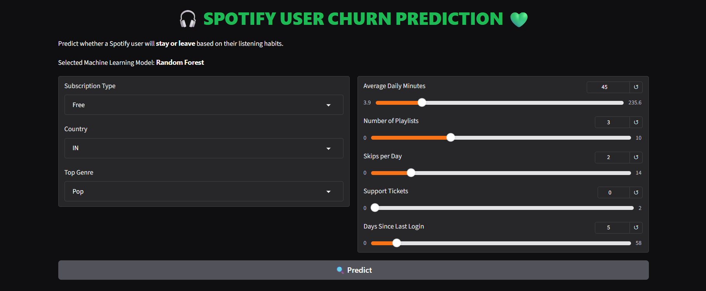
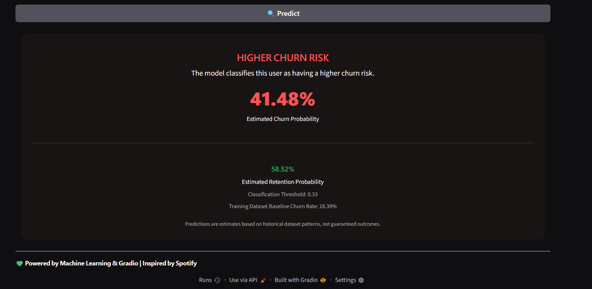

# 🎧 Spotify User Churn Prediction Using Machine Learning

An end-to-end Machine Learning project that predicts whether a Spotify user is likely to continue using the platform or churn, based on subscription details and listening behaviour.

The project compares multiple classification algorithms, selects the best-performing model using cross-validation, applies probability calibration and classification threshold optimization, and provides an interactive prediction interface built with **Gradio**.

---

## 📌 Project Overview

Customer churn is an important challenge for subscription-based platforms. Identifying users who are more likely to discontinue a service can help businesses understand customer behaviour and develop better retention strategies.

This project uses historical Spotify user data to build a binary classification model that estimates the probability of a user churning.

Users can enter customer details through an interactive Gradio interface and receive:
- Estimated churn probability
- Estimated retention probability
- Churn-risk classification
- Classification threshold
- Input-range warnings for values outside the training data range

## ✨ Key Features

- **Data Cleaning:** Handles invalid numerical values, missing target values, and identifier columns.
- **Data Preprocessing:** Uses median imputation, most-frequent categorical imputation, one-hot encoding, and standardization.
- **Model Comparison:** Evaluates Logistic Regression, Random Forest, and Extra Trees.
- **Cross-Validation:** Uses stratified 5-fold cross-validation with ROC-AUC scoring.
- **Model Selection:** Automatically selects the model with the highest mean cross-validation ROC-AUC.
- **Probability Calibration:** Applies sigmoid calibration to improve the reliability of predicted probabilities.
- **Threshold Optimization:** Selects a classification threshold using validation data and F1-score.
- **Model Evaluation:** Evaluates the final model on a separate, held-out test set.
- **Interactive Interface:** Provides real-time predictions through a Gradio web application.
- **Model Persistence:** Saves the trained model and associated metadata using Joblib.

## 🛠️ Tech Stack

| Technology | Purpose |
|---|---|
| Python | Core programming language |
| Pandas | Data manipulation and cleaning |
| NumPy | Numerical operations |
| Scikit-learn | Machine learning and preprocessing |
| Joblib | Model serialization |
| Gradio | Interactive web interface |

## 📂 Project Structure

```text
spotify-user-churn-prediction-ml/
│
├── assets/
│   ├── preview1.png
│   └── preview2.png
│
├── final.py
├── requirements.txt
├── .gitignore
├── README.md
└── spotify_churn_dataset.csv
```

## 📊 Dataset Information

**Dataset Source:** [Spotify Customer Churn Dataset – Kaggle](https://www.kaggle.com/datasets/abdulwadood11220/spotify-customer-churn-dataset)

The original dataset contains 1,000 user records and 10 columns.

### Features Used

| Feature | Description |
|---|---|
| subscription_type | User's subscription plan |
| country | User's country |
| avg_daily_minutes | Average daily listening time |
| number_of_playlists | Number of playlists created |
| top_genre | User's most-listened music genre |
| skips_per_day | Average number of daily skips |
| support_tickets | Number of support tickets |
| days_since_last_login | Days since the user's last login |

**Target Variable:** `churned`

- `0` – User retained
- `1` – User churned

The `user_id` column is excluded from model training because it is an identifier rather than a behavioural feature.

### Data Cleaning

The dataset is processed before model training:

- Missing target values are removed.
- Invalid negative numerical values are removed.
- Numerical and categorical missing values are handled through the preprocessing pipeline.
- The identifier column is excluded from the model.

In the previously reported run, 7 invalid records were removed, leaving 993 records for modelling. The final cleaned record count should be confirmed by running the latest version of `final.py`.

## ⚙️ Machine Learning Workflow

The project follows a structured machine learning workflow:

```text
             Dataset
                |
                v
          Data Cleaning
                |
                v
       Feature Selection
                |
                v
        Train-Test Split
                |
          80%     20%
           |       |
           v       |
    Model Comparison
           |
           v
    5-Fold Cross-Validation
           |
           v
      Best Model Selection
           |
           v
   Threshold Optimization
           |
           v
   Probability Calibration
           |
           v
     Final Model Training
           |
           v
   Held-Out Test Evaluation
           |
           v
       Model Saving
           |
           v
      Gradio Interface
           |
           v
     Churn Prediction
```

### 1. Data Preprocessing

A Scikit-learn `ColumnTransformer` is used to process numerical and categorical features.

**Numerical preprocessing:**
- Median imputation
- StandardScaler

**Categorical preprocessing:**
- Most-frequent imputation
- OneHotEncoder with `handle_unknown="ignore"`

Preprocessing is integrated into the machine learning pipeline to prevent information leakage between training and validation folds.

### 2. Model Comparison

Three classification algorithms are compared:

| Model | Description |
|---|---|
| Logistic Regression | Linear classification model |
| Random Forest | Ensemble learning using multiple decision trees |
| Extra Trees | Tree-based ensemble using randomized split selection |

The models are compared using stratified 5-fold cross-validation, with ROC-AUC as the selection metric.

The model with the highest mean cross-validation ROC-AUC is selected automatically.

### 3. Probability Calibration

The selected model is calibrated using `CalibratedClassifierCV` with sigmoid calibration.

This step aims to improve the reliability of predicted probabilities, making the churn probability estimates more useful for interpretation.

### 4. Classification Threshold Optimization

Instead of relying only on the default classification threshold of 0.50, the project searches multiple thresholds using a validation subset of the training data.

The threshold producing the highest validation F1-score is selected, with precision used as a tie-breaker.

The final model is then trained on the complete training set.

### 5. Final Model Evaluation

The final model is evaluated on a separate 20% held-out test set that is not used for model selection or threshold optimization.

The evaluation includes:

- Accuracy
- Precision
- Recall
- F1-score
- ROC-AUC
- Precision-Recall AUC
- Balanced Accuracy
- Brier Score
- Confusion Matrix
- Classification Report

## 📈 Model Performance

The following results are from a previously reported execution of the project.

**Selected Model:** Random Forest  
**Selected Classification Threshold:** 0.30

### Test Set Performance

| Evaluation Metric | Result |
|---|---:|
| Accuracy | 81.91% |
| Precision | 51.22% |
| Recall | 56.76% |
| F1-score | 53.85% |
| ROC-AUC | 85.17% |
| PR-AUC | 50.45% |
| Balanced Accuracy | 72.21% |
| Brier Score | 0.1162 |

### Model Comparison

| Algorithm | Mean Cross-Validation ROC-AUC |
|---|---:|
| Logistic Regression | 0.7665 |
| Random Forest | 0.7923 |
| Extra Trees | 0.7882 |

Random Forest achieved the highest mean cross-validation ROC-AUC in this run and was selected as the final model.

### Confusion Matrix

Results at the optimized threshold of 0.30:

```text
                 Predicted
                 0      1

Actual  0       142     20
        1        16     21
```

- True Negatives: 142
- False Positives: 20
- False Negatives: 16
- True Positives: 21

### Threshold Comparison

| Metric | Threshold 0.50 | Threshold 0.30 |
|---|---:|---:|
| Accuracy | 84.42% | 81.91% |
| Recall | 32.43% | 56.76% |
| F1-score | 0.4364 | 0.5385 |

Lowering the threshold improves the model's ability to identify potential churners, while increasing false-positive predictions. The selected threshold therefore represents a trade-off between identifying churners and incorrectly flagging retained users.

**Note:** These are previously reported results, not guaranteed results from every execution. Update this section using the output from the final committed version of `final.py` if the metrics differ.

## 🖥️ Application Preview

### Gradio Interface



### Prediction Output



## 🚀 Getting Started

Follow these steps to run the project locally.

### Prerequisites

- Python 3.9 or later
- pip
- Git

### 1. Clone the Repository

```bash
git clone https://github.com/YOUR-USERNAME/spotify-user-churn-prediction-ml.git
```

Replace `YOUR-USERNAME` with your GitHub username.

### 2. Navigate to the Project Directory

```bash
cd spotify-user-churn-prediction-ml
```

### 3. Create a Virtual Environment (Recommended)

```bash
python -m venv venv
```

Activate the environment:

**Windows:**

```bash
venv\Scripts\activate
```

**macOS/Linux:**

```bash
source venv/bin/activate
```

### 4. Install Dependencies

```bash
pip install -r requirements.txt
```

### 5. Run the Application

```bash
python final.py
```

The application will:
1. Load and clean the dataset.
2. Compare the machine learning models.
3. Select the best-performing model.
4. Optimize the classification threshold.
5. Train and evaluate the final model.
6. Save the trained model as `spotify_churn_model.joblib`.
7. Launch the Gradio interface.

Open the local URL displayed in your terminal to access the application.

## 🎯 How to Use the Application

1. Launch the Gradio application.
2. Select the user's subscription type.
3. Choose the country and top music genre.
4. Adjust the listening behaviour and activity inputs.
5. Click **Predict**.
6. View the estimated churn probability, retention probability, and churn-risk classification.

## 📁 Generated Model Artifact

After successful training, the application generates:

```text
spotify_churn_model.joblib
```

This file stores:

- Trained calibrated machine learning model
- Selected model name
- Cross-validation scores
- Optimized classification threshold
- Feature ranges
- Categorical options
- Training churn rate
- Feature metadata

The generated model artifact is excluded from Git through `.gitignore`. Running `final.py` recreates it from the dataset.

## ⚠️ Limitations

- The project uses a relatively small dataset of 1,000 original records.
- The held-out test set is a subset of the same Kaggle dataset, not an independent dataset collected from Spotify.
- Model performance may vary with different data splits.
- The dataset's patterns may not represent the behaviour of actual Spotify customers.
- Predicted probabilities and churn classifications are estimates, not guaranteed outcomes.
- The model is intended for educational and portfolio demonstration purposes, not production customer-retention decisions.

## 🔮 Future Improvements

- Deploy the Gradio application using Hugging Face Spaces.
- Experiment with additional machine learning algorithms and hyperparameter tuning.
- Evaluate model stability across repeated data splits.
- Explore explainability techniques such as SHAP.
- Incorporate larger and more representative datasets.
- Add visual analytics for customer behaviour and churn patterns.

## 👩‍💻 Author

**Simrat Kaur**

B.Tech Computer Science and Engineering (AI & ML)


---

*This project is an independent machine learning project inspired by Spotify's music-streaming platform. It is not affiliated with, endorsed by, or sponsored by Spotify.*

**If you find this project interesting, feel free to star the repository!** ⭐
